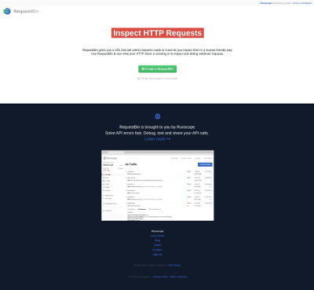
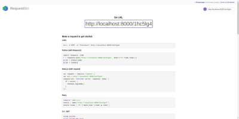
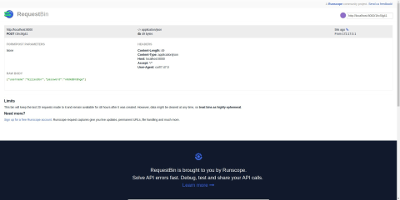
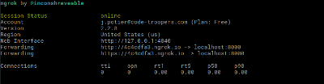
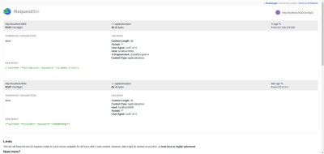
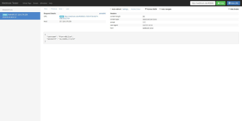

**[RequestBin](https://github.com/Runscope/requestbin)** est un service qui permet de tester très facilement des webhooks que l'on souhaite brancher à une API, ou bien encore de tester son client HTTP en inspectant les requêtes qui sont émises.
Ce service était auparavant acccessible en ligne, mais victime de son succès, il a ensuite été retiré. Cependant leurs créateurs ont mis à disposition de la communauté les sources afin de permettre à n'importe qui d'heberger sa propre instance de **RequestBin**.

Nous allons donc voir avec quelle simplicité il est possible de tester rapidement ce service en local sur sa machine, et comment il va nous aider par exemple à faire de l'intégration de webhooks externes. Afin de faire cela en un minimum de configuration nous allons également utiliser **[ngrok](https://ngrok.com/)**, un second outil très pratique qui permet d'exposer sur une url publique un service tournant sur sa machine en local.

## **RequestBin**

### Déploiement

_Prérequis_ : disposer de docker et de docker-compose sur la machine qui va heberger le service.

* Récupérer les sources de **[RequestBin](https://github.com/Runscope/requestbin)**
```shell
$ git clone git://github.com/Runscope/requestbin.git
```

* Construction du service
```shell
$ cd requestbin
$ sudo docker-compose build
```

* Démarrage du service
```shell
$ sudo docker-compose up -d
```

C'est tout, le service est alors disponible sur le port 8000.

<div style="text-align : center">
<a style="display: inline" href="/images/posts/2018-05-02_requestbin-ngrok/homepage.png" data-lightbox="0" title="Page d'accueil">
        
</a>
</div>
<br/>

Il est à noter que le projet est également préconfiguré pour deployer rapidement le service sur Heroku, seul l'addon `heroku-redis` est nécessaire : se référer à la documentation pour davantages d'informations à ce sujet.

### Visualisation de requêtes HTTP

Une fois le service démarré, il est alors possible de commencer à débugger nos requêtes HTTP en quelques secondes.

Pour cela il suffit de cliquer sur `Create a RequestBin`. Un _Bin_ va alors être généré et permettra donc d'écouter toutes les requêtes entrantes. Il s'agit ni plus ni moins d'un endpoint dynamique qui va accepter toutes les requêtes HTTP entrantes.

<div style="text-align : center">
<a style="display: inline" href="/images/posts/2018-05-02_requestbin-ngrok/first_bin.png" data-lightbox="0" title="Exemple de Bin">
        
</a>
</div>
<br/>

Ensuite, comme l'indique le _Bin_ on va pouvoir commencer à jouer avec en branchant nos webhooks ou clients à tester sur cette url, dans notre exemple il s'agit de `http://localhost:8000/1hc5lg41`.
Voyons le résultat d'une requête POST d'un objet JSON quelconque :

```shell
$ curl -H "Content-Type: application/json" -d '{"username":"GillesDor","password":"v0dk@0r@nge"}' http://localhost:8000/1hc5lg41
```

<div style="text-align : center">
<a style="display: inline" href="/images/posts/2018-05-02_requestbin-ngrok/result.png" data-lightbox="0" title="Visualisation d'une requête">
        
</a>
</div>
<br/>

Après avoir rafraîchi la page, il est alors très simple de visualiser le résultat reçu par notre _Bin_ : headers, body, paramètres, …

Il devient alors très facile d'analyser les requêtes entrantes d'un webhook que l'on souhaite brancher à notre API avant d'implémenter son intégration à proprement parler. À l'inverse cela peut permettre également de voir les données qui vont être reçues par une API que l'on souhaite attaquer avec son propre client HTTP.

## Redirection de requêtes sur son environnement avec ngrok

Afin d'aller plus loin dans la démarche, il peut être parfois nécessaire de configurer un webhook externe sur une url publique pour que ce dernier puisse nous envoyer ses requêtes.

Imaginons que l'on veuille d'abord tester les résultats envoyés par ce webhook en utilisant **RequestBin**. On a alors probablement lancé le service en local sur sa propre machine, qui elle même se trouve (au minimum) derrière un routeur que l'on a pas la possibilité (ou l'envie) de configurer pour effectuer la redirection de ports adequat pour atteindre notre machine.

Nous allons pouvoir nous abstraire de tout cela grâce à **[ngrok](https://ngrok.com/)**. Il s'agit d'un petit outil qui permet d'exposer des services locaux sur des urls publiques (en HTTP ou HTTPS), sans avoir à faire de quelconque configuration de notre équipement réseau.

### Installation

Il s'agit d'un simple [binaire à télécharger](https://ngrok.com/download). Il est aussi possible de se créer un compte si l'on souhaite administrer plus finement les tunnels que l'on veut créer mais cette étape reste facultative pour le simple usage que nous souhaitons en faire.

### Création de tunnel

Une fois **ngrok** installé il est ensuite possible de monter une url publique vers notre serveur local en une seule commande :

```shell
$ ngrok http 8000 -host-header="localhost:8000"
```

<div style="text-align : center">
<a style="display: inline" href="/images/posts/2018-05-02_requestbin-ngrok/ngrok.png" data-lightbox="0" title="ngrok">
        
</a>
</div>
<br/>

Ici nous venons donc d'exposer notre serveur accessible sur le port 8000 de notre machine sur une url publique fournie par **ngrok**.
Ce dernier nous indique alors une url dynamique publique à utiliser, dans notre exemple il s'agit donc de `https://4c4cdfa3.ngrok.io` (ou en HTTP).

À partir de là nous avons bien accès à notre **RequestBin** local sur une url publique.

### Branchement du webhook

Toute la mécanique est alors en place pour paramétrer correctement notre webhook public pour lui permettre de logger ses requêtes dans notre **RequestBin** local.
En effet il suffit de lui fournir comme url : `https://4c4cdfa3.ngrok.io/1hc5lg41`.

Afin de vérifier cela, un simple appel curl nous permettra de valider notre installation :

```shell
$ curl -H "Content-Type: application/json" -d '{"username":"PierreBillon","password":"la_bamba_triste"}' https://4c4cdfa3.ngrok.io/1hc5lg41
```

<div style="text-align : center">
<a style="display: inline" href="/images/posts/2018-05-02_requestbin-ngrok/result_final.png" data-lightbox="0" title="Résultat final">
        
</a>
</div>
<br/>

## Conclusion

Nous avons donc réussi à mettre en place un moyen de visualiser les requêtes HTTP entrantes d'un webhook public grâce à **RequestBin** et **ngrok**, et à moindre coût.

Dans la vraie vie cela permettra donc de visualiser les données reçues lorsque l'on veut intégrer les webhooks d'un quelconque service, avant ou pendant l'implémentation à proprement parler, pour avoir un contrôle sur les données qui vont transiter.

Effectivement, selon les services à intégrer la documentation des webhooks est généralement suffisante pour appréhender ces problématiques mais cela peut parfois être intéressant de manipuler directement les requêtes pour anticiper certains cas ou incompréhensions de la documentation.

## Bonus

Nous avons vu une technique basée sur **RequestBin** pour logguer des requetes HTTP entrantes, moyennant quelques commandes à effectuer sur son poste. Il existe en fait d'autres services en ligne pour effectuer cela…
On pourra citer notamment **[Webhook Tester](https://webhook.site)** qui est une solution clef en main pour tester des webhooks, comme son nom l'indique, et qui gère pour nous la mise à disposition d'une url publique.

<div style="text-align : center">
<a style="display: inline" href="/images/posts/2018-05-02_requestbin-ngrok/webhook_tester.png" data-lightbox="0" title="Webhook Tester">
        
</a>
</div>
<br/>
