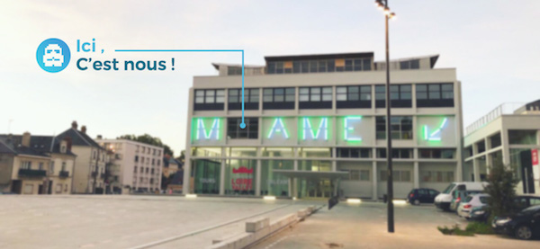
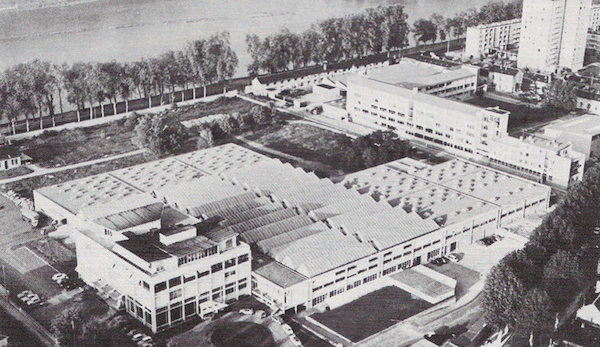
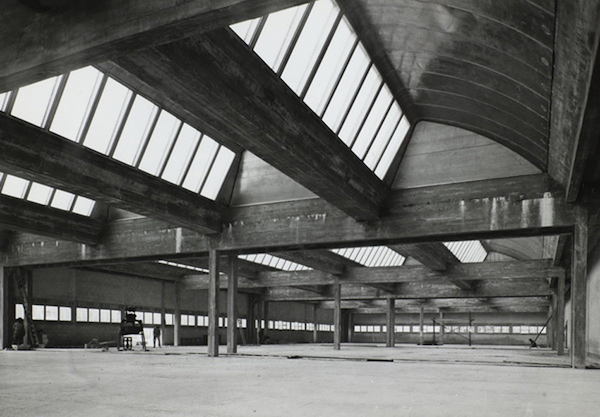
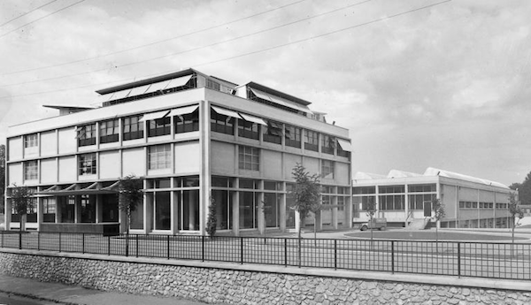
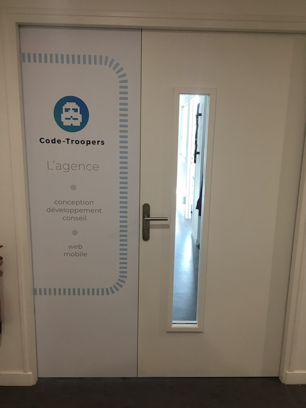
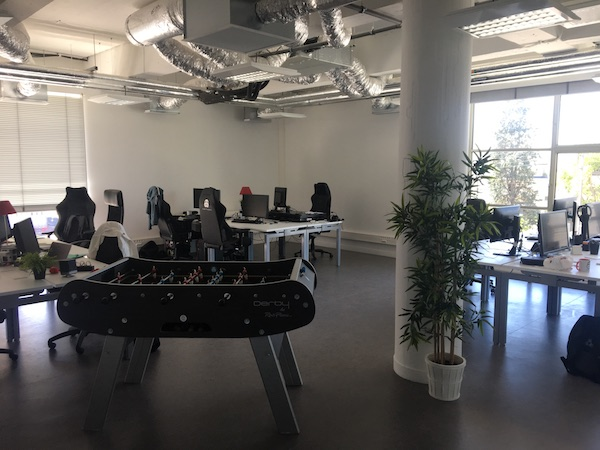
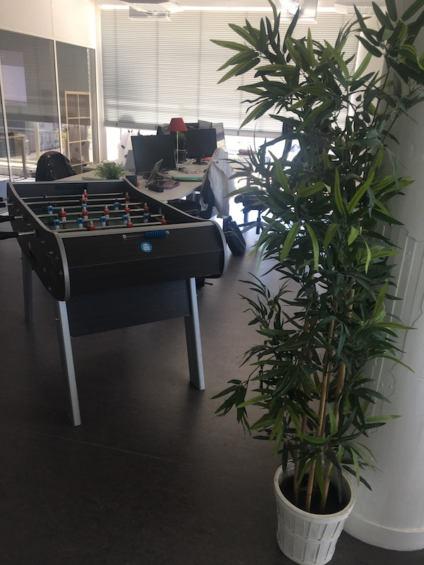
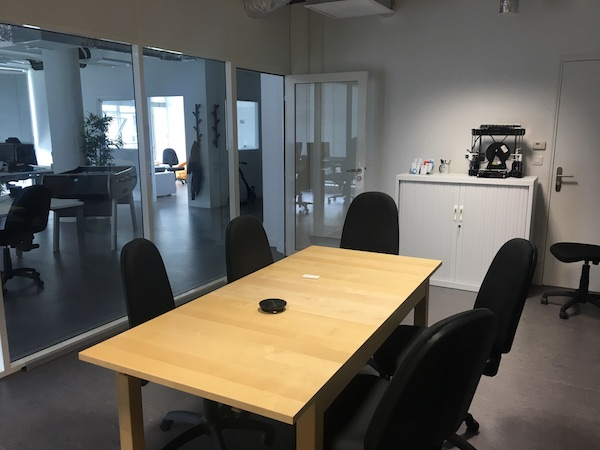
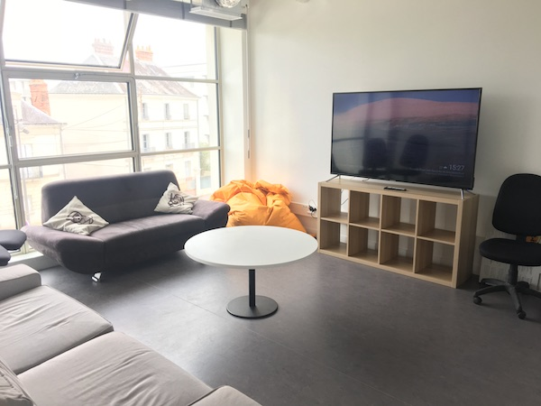

Cela fait maintenant un peu plus d'un mois que nous nous sommes installés dans nos nouveaux bureaux. Aurevoir les ateliers, et bonjour à la tour ! Grand voyage n'est-ce pas ? Nous avons quand même pris un peu de hauteur.
Pour nous trouver c'est facile, une fois face à MAME, nous sommes entre le M et le A !

 

## Un peu d'histoire

MAME est une ancienne imprimerie créée par la famille d'imprimeurs du même nom. Construite en 1950, l'imprimerie est composée de deux bâtiments, le premier édifice est une tour dans laquelle il y avait les bureaux administratifs et le deuxième regroupait les ateliers.

 

 

 

L'imprimerie a été réhabilitée en 2016 pour en faire un lieu dédié à la création et au numérique. La tour accueille des sociétés (comme nous), mais aussi l'école supérieure des Beaux-Arts de Tours et l'école du Cercle digital (anciennement ESTEN). Dans les ateliers on trouve d'autres sociétés innovantes.

## Les locaux

Grâce à ce déménagement, nous avons gagné en superficie, mais surtout en luminosité ! Pour ceux qui connaissaient nos anciens locaux il n'y a pas de comparaison possible. En revanche, on retrouve toujours le style industriel typique de MAME avec ses gaines et ses tuyaux apparents.

 

### L'open space

Nous avons un grand open space qui nous permet d'accueillir nos stagiaires et alternants, ainsi que les amis de passage en manque de bonne humeur et de bonne musique !

 

Nous avons bien évidemment gardé de la place pour notre babyfoot qui nous rappelle nos souvenirs d'école d'ingénieur et nous permet de décompresser.

 

### La salle de réunion

Afin d'accueillir au mieux nos clients, et continuer à réaliser nos nombreux et prolifiques brainstorming, nous avons une belle salle de réunion.

 

### La salle de pause

Enfin la salle de pause dans laquelle on peut profiter des canapés et de la machine à café le temps de reprendre des forces.

 

Hormis quelques soucis de climatisation, nous sommes plutôt bien installés. Encore un peu d’aménagement et de décoration nous permettront de nous approprier pleinement les lieux.

N'hésitez pas à venir nous voir si vous voulez visiter ou juste faire une partie de babyfoot.
