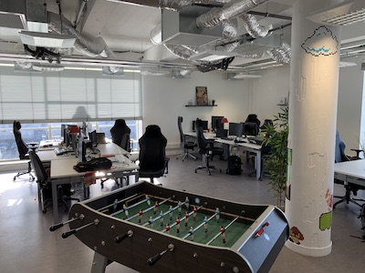

👩‍🎓👨‍🎓 Voici nos offres de stages pour 2020, ça se passe à MAME et le baby-foot ⚽ est pas loin pour se détendre entre deux lignes de codes.

 

* Développement Frontend / Backend / IOT : [Stage_2020_AGEN](https://code-troopers.com/files/Stage_2020_AGEN.pdf)
* Développement Frontend et/ou Backend : [Stage_2020_VU3](https://code-troopers.com/files/Stage_2020_VU3.pdf)

Ce stage sera rémunéré selon les conditions légales, plus une prime dépendant du résultat final.

Pour postuler vous pouvez envoyer vos C.V. à : stage@code-troopers.com
